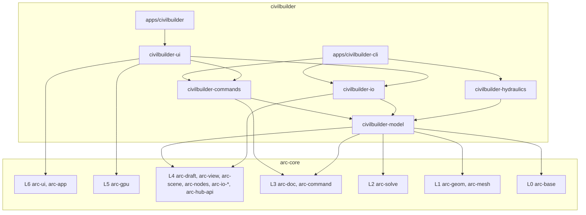

# CivilBuilder

> **Status: design phase.** No builds are available yet. This repository contains the product definition, architecture and roadmap that implementation follows.

CivilBuilder is the Arc application for civil infrastructure design. It models survey data,
terrain, alignments, profiles, corridors, grading, parcels, gravity and pressure networks with
hydraulic analysis, rail, bridges and concept infrastructure in a geospatial context in one semantic
document, and produces sheets, quantities and open exchange files from it. The dependency chain from
surface to alignment, profile, corridor, sections and quantities runs on a multi-threaded,
incremental regeneration graph. It is written in Rust, runs on Windows, macOS and Linux, and works
offline without an account. The same crates also build for the browser and for tablets, and
connectors running inside other applications exchange native civil design objects with it.

## Who it is for

Transportation, land development, drainage and utility engineers; surveyors; rail designers;
planners working on early-stage alternatives; CAD and standards managers; and contractors who need
quantities and machine-control models.

## Capability areas

| Area | Scope |
|---|---|
| [Geospatial](docs/product/capabilities/01-geospatial.md) | CRS, datums, ground and grid, live GIS layers and streaming tiles |
| [Survey](docs/product/capabilities/02-survey.md) | Points, groups, description keys, survey database, raw observations, figures, adjustment |
| [Surfaces](docs/product/capabilities/03-surfaces.md) | TIN and grid surfaces, editing, analysis, volumes |
| [Alignments](docs/product/capabilities/04-alignments.md) | Horizontal geometry, criteria, superelevation, widenings |
| [Profiles](docs/product/capabilities/05-profiles.md) | Surface and layout profiles, profile views and bands |
| [Assemblies](docs/product/capabilities/06-assemblies.md) | Node-graph cross-section components and assemblies |
| [Corridors](docs/product/capabilities/07-corridors.md) | Baselines, regions, targets, station-range rebuild, outputs |
| [Intersections](docs/product/capabilities/08-intersections.md) | Intersections, curb returns, roundabouts and checks |
| [Sections](docs/product/capabilities/09-sections.md) | Sample lines, sections, section views |
| [Quantities](docs/product/capabilities/10-quantities.md) | Materials, earthwork, pay items, mass haul |
| [Grading](docs/product/capabilities/11-grading.md) | Feature lines, gradings, optimization |
| [Parcels](docs/product/capabilities/12-parcels.md) | Topology, lot layout, map checks |
| [Gravity networks](docs/product/capabilities/13-gravity-networks.md) | Storm and sanitary pipes and structures |
| [Pressure networks](docs/product/capabilities/14-pressure-networks.md) | Pressure pipes, fittings, appurtenances |
| [Hydrology](docs/product/capabilities/15-hydrology.md) | Runoff, network hydraulics, channels, culverts, storage, two-dimensional flood modeling |
| [Rail](docs/product/capabilities/16-rail.md) | Track geometry, cant, turnouts, clearances |
| [Bridges](docs/product/capabilities/17-bridges.md) | Bridges, culverts, walls, tunnels |
| [Plan production](docs/product/capabilities/18-plan-production.md) | Sheet frames, plan, profile and section sheets |
| [Styles and labels](docs/product/capabilities/19-styles-labels.md) | Object styles, label styles, tables, libraries |
| [Collaboration](docs/product/capabilities/20-collaboration.md) | Shared references, comparison, Arc Hub |
| [Concept modeling](docs/product/capabilities/21-concept-modeling.md) | Concept roads and structures in context, options |
| [Concept analysis](docs/product/capabilities/22-concept-analysis.md) | Sight, visibility, flood, traffic, pedestrian movement, noise |
| [Swept paths](docs/product/capabilities/23-swept-paths.md) | Vehicles, swept paths, parking |
| [Reality data](docs/product/capabilities/24-reality-data.md) | Point clouds, meshes, boreholes |
| [Automation](docs/product/capabilities/25-automation.md) | Commands, protocol, CLI, graphs, plug-ins |
| [Interoperability](docs/product/capabilities/26-interoperability.md) | LandXML, IFC 4.3, DWG/DXF, PDF, machine control |
| [Application connectors](docs/product/capabilities/27-application-connectors.md) | Exchange of native civil objects with other applications, licensed bridges, open readers |
| [Web and tablet](docs/product/capabilities/28-web-and-tablet.md) | Browser and tablet builds: viewing, position inspection, markups, offline use |

## How it fits in the suite

CivilBuilder depends only on [`arc-core`](https://github.com/ACKaraca/arc-core) and cooperates with
other Arc products at run time through three contracts:

- **Arc document package** for its native `.civilb` documents, shared references and shared
  coordinates with ArchBuilder and other Arc documents.
- **Arc Scene** for photoreal rendering and presentation frames in RenderBuilder.
- **Hub API** for versions, locks, issues, reviews and multi-user editing through Arc Hub.

Sheets and annotation use the shared drafting engine `arc-draft`; DWG and DXF are exchange formats.
Exported IFC models open in Arc Review for coordination.

## Architecture at a glance

Details: [architecture overview](docs/architecture/overview.md).

## Roadmap

CivilBuilder starts in suite phase 3. Milestones M1 to M3 deliver terrain and survey, the linear
design chain, and a first production release with sections, quantities, grading, plan production,
shared references, LandXML and IFC 4.3. Phase 4 adds parcels, intersections, roundabouts, swept
paths, concept modeling and point clouds; phase 5 adds networks with hydraulics, rail, bridges,
multi-user editing, two-dimensional flood and pedestrian studies, raw survey data reduction,
exchange connectors for other applications, and browser and tablet builds. See the [roadmap](docs/roadmap.md).

## Documentation

The [documentation map](docs/README.md) lists every document: vision, capabilities, workflows,
open questions, architecture, decisions and glossary.

## Contributing

Read [CONTRIBUTING.md](CONTRIBUTING.md) and [AGENTS.md](AGENTS.md). Work starts from an issue;
commits follow Conventional Commits with a Developer Certificate of Origin sign-off. Security issues
are reported as described in [SECURITY.md](SECURITY.md).

## License

Licensed under the Apache License, Version 2.0. See [LICENSE](LICENSE) and [NOTICE](NOTICE).

## Trademarks

Arc, ArchBuilder, DraftBuilder, CivilBuilder, SolidBuilder, MeshBuilder, RenderBuilder, Arc Review and Arc Hub are names of this project and are not covered by the Apache License; see the [trademark policy](https://github.com/ACKaraca/arc-suite/blob/main/TRADEMARKS.md). All other product and company names are trademarks of their respective owners and are used only to describe scope and interoperability.
