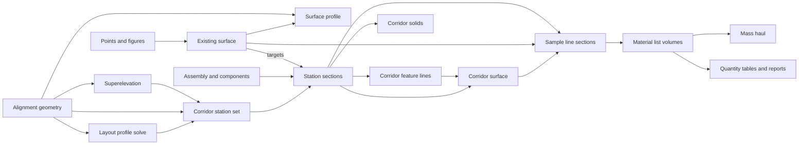

# Dependency chain

How the dynamic chain surface → alignment → profile → corridor → sections → quantities runs on the
`arc-doc` regeneration graph: dependency edges, invalidation by station range, parallel rebuild,
rebuild policies and failure reporting. The governing decision is
[ADR-0002](../adr/0002-station-range-regeneration.md).

## Graph nodes and edges

Each derived result is a node; each node declares its inputs. Authored objects are sources; derived
data is never a source except through an explicit output definition (for example a corridor surface).

| Edge | Carried change extent |
|---|---|
| Surface → surface profile | Planar region of the surface change, mapped to station ranges where the alignment crosses it |
| Alignment → profile, station set, sample lines | Station range of changed elements, extended through constraint neighbors that re-solved |
| Layout profile → station set and sections | Station span of changed vertical elements and their curves |
| Superelevation → sections | Station range between the outer critical stations of changed curves |
| Assembly → sections | All stations of regions that use it (whole-region extent) |
| Target object → sections | Station ranges where the target is within reach of the mapped components (computed from the target's change region and the region's maximum assembly width) |
| Station sections → feature lines, corridor surfaces, solids | Station intervals adjacent to changed stations |
| Corridor surface → sample line sections | Sample lines whose swath intersects the changed region |
| Sections → material lists | Intervals between affected sample lines |
| Material list → mass haul | All stations from the first affected interval to the end (cumulative quantity) |

## Invalidation granularity

- **Station ranges** are the unit of invalidation for linear objects. A change produces a set of
  closed internal-distance intervals; ranges merge when closer than one frequency increment.
- **Regions** (planar polygons) are the unit for surfaces, sites and context data. Surfaces are
  tiled; only tiles intersecting the region rebuild.
- **Whole object** is used only when no finer extent is meaningful (assembly definition changes,
  frequency set changes, CRS changes).
- Each node keeps a per-range state: current, stale, computing, failed. The station set itself is
  recomputed for the changed range and merged, so unchanged stations keep their cache keys.

## Parallel rebuild

1. The scheduler takes the invalidated ranges, orders nodes topologically, and splits station work
   into batches of contiguous stations.
2. Station section evaluation is a pure function of (assembly instance values, baseline state at the
   station, superelevation at the station, target geometry near the station). Batches run in parallel
   on the work-stealing pool with no shared mutable state.
3. Targets are read through immutable snapshots of the current revision, so concurrent stations never
   observe a partially applied change.
4. Downstream nodes start on a range as soon as their inputs for that range are current (pipelining);
   a corridor surface tile rebuilds when all stations it spans are done.
5. Visible stations and the active section editor station are scheduled first.
6. Every result carries the revision it started from. When a newer transaction invalidates a range
   being computed, the stale work is cancelled or its result discarded on arrival.

## Rebuild policies

| Policy | Behavior |
|---|---|
| Automatic | Invalidated ranges rebuild in the background after each transaction. Default for surfaces, alignments, profiles and corridors. |
| On demand | Ranges are marked stale and listed; a rebuild command computes them. Downstream nodes show stale too. |
| Frozen | Outputs stay at their last computed revision while inputs change; unfreezing invalidates the accumulated ranges. Used to protect a reviewed state. |
| Static copy | Outputs are copied into authored static objects with no inputs; used for records and handover. |

Policies are per object and stored in the document; the CLI can override them for one run (for
example force automatic for a headless export).

## Cycles

Edges are validated at commit. A target mapping, shared reference or link that would create a cycle
(for example a corridor targeting a surface built from its own outputs) is rejected and the command
reports the objects on the cycle. Feature lines from one baseline may target another baseline only in
an acyclic order.

## Failure reporting

- A failure is recorded per node and range with: object, baseline, station (or region), component or
  operation, message, and the input revision.
- A failed station produces no section; adjacent outputs bridge the gap only if the output definition
  allows it, otherwise they break and report the break.
- The rest of the graph continues; a failure never aborts other ranges or other objects.
- Failures are listed in the checks panel, shown as markers at their station, available through
  the automation protocol and written by `civilbuilder-cli rebuild` as a machine-readable report with a
  non-zero exit code when any failure remains.
- Faults inside a component evaluation (for example an evaluation step limit exceeded) are contained
  by the evaluator and reported as failures; they never terminate the application.

## Persistence of derived data

Station sections and surface tiles may be persisted in the document package as caches keyed by input
hashes, so large documents open without a full rebuild. Caches are optional: deleting them never loses
information, and a cache whose key does not match is ignored.
