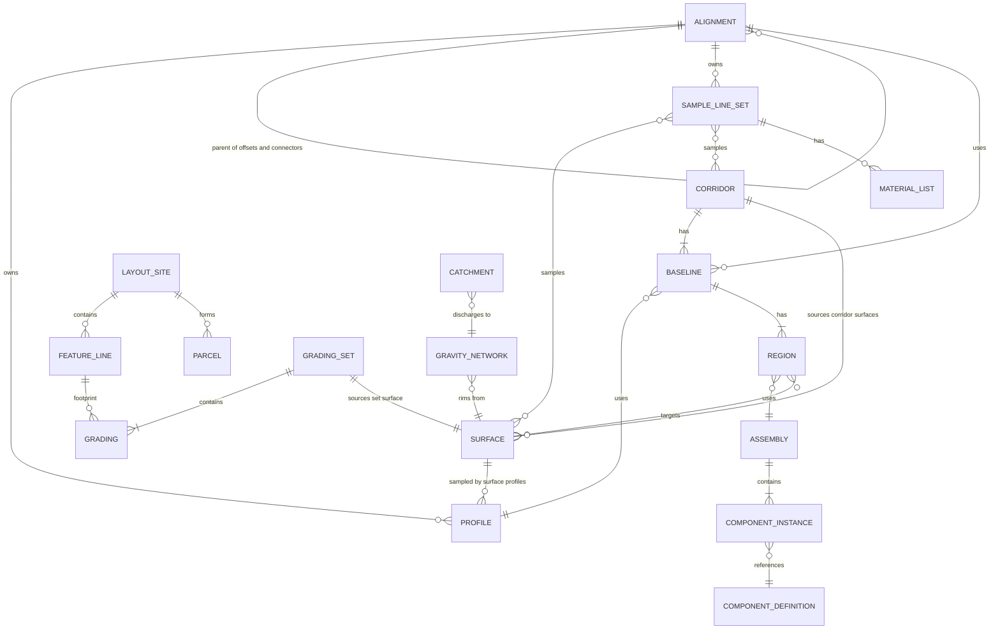

# Domain model

The object types of a CivilBuilder document, their key properties, relationships, invariants,
identity rules and regeneration rules. All objects live in the `arc-doc` object store of one
`.civilb` document package ([ADR-0001](../adr/0001-civil-model-in-document-package.md)).

## Conventions

- Lengths are stored in meters, angles in radians, slopes as rise over run (dimensionless), all as
  f64 in the document CRS (suite ADR-0008). Stations are stored as internal distance along the
  alignment; displayed stations are computed through station equations.
- Every object has a stable 128-bit identifier assigned at creation and never reused. References
  between objects are by identifier.
- **Authored** properties are written only by commands. **Derived** data is computed by the
  regeneration graph, cached with the revision it was computed from, and never edited directly.
- Every object has a `style` reference (identifier into the style resources) and optional label
  attachments; neither takes part in regeneration of design data.

## Object types

### Reference and context

| Type | Key authored properties | Derived data |
|---|---|---|
| `CoordinateReference` (one per document) | horizontal CRS definition (WKT2), vertical reference, transformation pipeline, local origin, scale settings, display units | combined scale factor function |
| `GeoSource` | URI or asset reference, source CRS, layer filter, attribute mapping profile, display rules | reprojected feature index, tile cache entries |
| `PointCloud` | asset reference, CRS, transform, classification edit layer | spatial index (cache beside the document) |
| `Borehole` | location, collar elevation, strata intervals, groundwater, test values | none |

### Survey

| Type | Key authored properties | Derived data |
|---|---|---|
| `Point` | number (unique), name, northing, easting, elevation (optional), raw description, lock, user properties, optional elevation link to a `Surface` | full description, resolved style from description keys and groups |
| `PointGroup` | include/exclude rules, overrides, priority | member set |
| `DescriptionKeySet` | ordered rules, precedence | none |
| `SurveyNetwork` | control points, setups, observations (raw), equipment references, settings | reduced observations, adjustment result |
| `Figure` | name, ordered point references or vertices, closed flag, breakline flag, prefix rule | 3D polyline |
| `EquipmentProfile`, `LineworkCodeSet`, `FigurePrefixRule` | configuration values | none |

### Terrain and linear design

| Type | Key authored properties | Derived data |
|---|---|---|
| `Surface` | kind (TIN, grid, TIN volume, grid volume, composite, sourced), ordered operations list (definition items and edits), rebuild policy, snapshot reference | triangulation or grid (tiled when large), statistics, analysis ranges, contours |
| `Alignment` | kind, ordered elements with constraint state and authored parameters, start station and reference, station equations, design speeds, criteria set reference, superelevation set, widenings, parent (for offset and connector kinds), layout site | solved element geometry, geometry points, check findings, superelevation critical stations |
| `Profile` | owning `Alignment`, kind, vertical intersection points and curves (layout), or sources and sampling (surface, derived), offset | solved vertical geometry, sampled elevations, check findings |
| `ComponentDefinition` | node graph, parameters, targets, version, test cases | none |
| `Assembly` | attachment point, left and right chains of `ComponentInstance` (definition reference and version, parameter values, attachment point name, code renames) | validation findings |
| `Corridor` | baselines (alignment and profile, or path), regions (station range, assembly, frequency set, target mapping, overrides), output definitions (surfaces, feature line options, solids), rebuild policy | station set, station sections, feature lines, corridor surfaces, solids, failure list |
| `Intersection`, `Roundabout` | leg references, parameters, crown rule, corner definitions, generated-object override records | generated alignments, profiles, regions (as authored objects written by the regeneration command), check findings |
| `SampleLineSet` | owning `Alignment`, sample lines (station, swaths, vertices), sources and update modes | sections per source and line |
| `MaterialList` | owning `SampleLineSet`, materials, methods, factors | areas per section, volumes, mass haul line |

### Site, networks and structures

| Type | Key authored properties | Derived data |
|---|---|---|
| `LayoutSite` | name; membership of feature lines, alignments and parcel segments | topology faces and split points |
| `FeatureLine` | vertices, elevation points, arc segments, layout site, elevation links | segment grades, draped geometry |
| `Grading` | footprint `FeatureLine` and range, criteria reference, target | projection geometry, daylight line |
| `GradingSet` | gradings, infills, base surface | set surface, volumes |
| `Parcel` | number, name, use, user properties (geometry comes from site topology) | area, perimeter, segments |
| `GravityNetwork`, `PressureNetwork` | parts with family, size, positions, inverts, rims or depths, connections, status, parts list, rule sets, reference surface and alignment | rule findings, rims from surface, solids |
| `Catchment`, `Channel`, `Culvert`, `Storage` | boundary, parameters, links to network nodes | flow paths, times of concentration, stage-storage |
| `AnalysisScenario` | rainfall, loads, parameters, network state | analysis model, result set (revision-tagged) |
| `Bridge`, `RetainingWall`, `Tunnel` | baseline reference, stations, supports, deck components, parameters | deck and support geometry, clearance findings |
| `Track` (alignment kind rail) with `CantSet`, `TurnoutInstance`, `Platform` | cant parameters, turnout definition and station, platform parameters | diverging alignments, envelopes |
| `SweptPath` | vehicle reference, guide object or driven segments, speed, direction | envelopes, conflicts |
| `ParkingRow`, `ParkingArea` | edge reference, standard, angle, side | bays, counts |

### Production and resources

| Type | Key authored properties | Derived data |
|---|---|---|
| `SheetFrameSet` | alignment, template, scale, overlap, frame overrides | frames, match lines |
| `Sheet` | `arc-draft` layout, frame or arrangement reference, manual annotation | generated viewports and fields |
| `ProfileView`, `SectionView` | source objects, ranges, bands, style | graph geometry |
| Styles, label sets, table styles, criteria sets, catalogs, libraries | see [styles and labels](styles-and-labels.md) | resolved values |
| `SharedReference` | source document identifier, source object identifier, last synchronized revision, local style | read-only replica of the source object |
| `DesignOption` | name, member objects | metrics |

## Relationships

## Invariants

| Object | Invariant |
|---|---|
| `Point` | Numbers are unique in a document; a locked point is never modified by any command except unlock. |
| `Alignment` | Elements form a connected chain; constrained joints are tangent within the angular tolerance; a free element has two neighbors; station equations are strictly ordered by internal distance. |
| `Profile` | Vertical intersection points are strictly increasing in station; a vertical curve does not overlap its neighbors; a layout profile belongs to exactly one alignment. |
| `Surface` | The operations list is the only definition; replaying it yields the stored triangulation; no two vertices share planar position within tolerance. |
| `Corridor` | Regions of one baseline do not overlap (overlaps are rejected at commit unless explicitly allowed, then reported); target mappings refer to existing objects or are marked unresolved; no dependency cycle passes through the corridor. |
| `ComponentInstance` | Parameter values are within declared limits and refer to an available definition version. |
| `LayoutSite` | Topology faces cover exactly the closed regions formed by member segments; split points carry one elevation shared by all crossing feature lines. |
| Networks | Every connection references existing parts; a pipe connects at most two structures or fittings. |
| `SharedReference` | Replica data is read-only; only synchronization writes it. |
| Any derived data | Carries the revision it was computed from; a result for an older revision is never displayed as current. |

## Identity rules

- Identifiers are assigned at creation and survive save, copy within a document (copies get new
  identifiers), undo and redo, and export and re-import where the format can carry them (IFC
  GlobalId, LandXML and DXF extended data).
- Generated objects (intersection alignments, roundabout islands, turnout diverging tracks) receive
  identifiers derived deterministically from the generator identifier and a role name, so
  regeneration updates the same objects instead of replacing them.
- Station sections are not objects; they are cache entries keyed by corridor, baseline and internal
  station rounded to the station tolerance.
- Imported objects store the source identifier; re-import updates matching objects (CB-IO-015).
- Shared references keep the source object identifier; promotion creates a new identifier and
  records the source.

## Regeneration rules

What recomputes when what changes; granularity and scheduling are specified in
[the dependency chain](dependency-chain.md).

| Change | Recomputes |
|---|---|
| Point coordinates or description | Point group membership; surfaces using those points (affected region); figures through them; parcels or feature lines linked to them |
| Surface definition item or edit | Surface (affected tiles); surface profiles over the crossing station ranges; corridor stations targeting it within the affected region; sections; volumes; gradings targeting it; rims of linked structures |
| Alignment element | Dependent elements in the constraint chain; offset and connector children; profiles (surface profiles resampled over the changed station range); corridor stations in that range; sample lines and sections in that range; labels; sheet frames whose range intersects |
| Layout profile element | Corridor stations within the element's station span plus transition neighbors; sections; material lists; mass haul from the first affected station onward |
| Assembly or component definition | All stations of regions using it |
| Region override | Stations within the override range and its interpolation span |
| Corridor station result | Feature lines and corridor surfaces over the adjacent station intervals; solids in those intervals; sections at sample lines in the range |
| Feature line vertex | Crossing feature lines through split points; gradings using it; grading set surface and volumes; surfaces using it as breakline |
| Network part | Connected parts if rules reapply on edit; profile and section displays; interference results; analysis results become stale |
| Style or label style | Display only; no design data recomputes |
| Shared reference synchronization | Replica, then the same rules as a local change of that object type |
