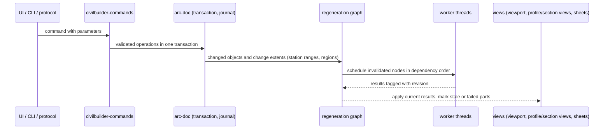

# Architecture overview

How CivilBuilder is built on `arc-core`: its crates, runtime flows, civil subsystems, threading,
performance targets, automation surface and testing strategy. Suite-wide decisions are in the
[suite ADRs](https://github.com/ACKaraca/arc-suite/tree/main/docs/adr) and are not repeated here.

## Crates

```
civilbuilder/
  crates/
    civilbuilder-model/       domain objects, rules, regeneration nodes (headless)
    civilbuilder-commands/    user-level commands and queries on the model (headless)
    civilbuilder-io/          mapping between the model and LandXML, IFC, DWG/DXF, GIS, hydraulic and rail formats (headless)
    civilbuilder-hydraulics/  hydraulic engine boundary: model translation, worker protocol, result import (headless)
    civilbuilder-ui/          tools, panels, editors, viewport interaction (egui)
  apps/
    civilbuilder/             desktop application (wiring only)
    civilbuilder-cli/         headless CLI: convert, validate, rebuild, check, report, serve the automation protocol
  docs/
  xtask/
```

| Crate | Responsibility | Depends on |
|---|---|---|
| `civilbuilder-model` | Object types of the [domain model](domain-model.md), invariants, geometry evaluation of alignments, profiles, assemblies and corridors, regeneration node definitions, style and label resolution data | `arc-base`, `arc-geom`, `arc-mesh`, `arc-solve`, `arc-doc`, `arc-nodes`, `arc-draft` (types only) |
| `civilbuilder-commands` | Every user-level command with parameter schema, validation and interactive prompt machine; typed queries | `civilbuilder-model`, `arc-command` |
| `civilbuilder-io` | Format mappings using neutral format models from `arc-io-*`; loss reports; source identifier maps | `civilbuilder-model`, `arc-io-geo`, `arc-io-ifc`, `arc-io-dxf`, `arc-io-dwg`, `arc-io-pdf`, `arc-io-pointcloud`, `arc-io-mesh`, `arc-io-bcf` |
| `civilbuilder-hydraulics` | Translation of design objects into analysis models, the worker-process protocol, result mapping back to objects ([ADR-0005](../adr/0005-hydraulic-engine-boundary.md)) | `civilbuilder-model`, `arc-base` |
| `civilbuilder-ui` | Layout tools, parameter grids, section editor, component graph editor (on the `arc-ui` node editor), profile and section view interaction, check panels | `civilbuilder-commands`, `arc-ui`, `arc-gpu`, `arc-app` |

The hydraulics crate exists because the engine boundary is a real second boundary (a separate
process with its own protocol and failure modes). No other crate is added until a second concrete
user exists.

### Use of `arc-core`

| `arc-core` crate | Used for |
|---|---|
| `arc-base` | Identifiers, quantities (lengths in meters, angles in radians), tolerances, error types |
| `arc-geom` | Curves (lines, arcs, spirals as curve types), 2D regions for parcels and boundaries, constrained triangulation and TIN, spatial indexes for points and triangles |
| `arc-mesh` | Corridor and structure meshes, surface display meshes, mesh booleans for interference |
| `arc-brep` | Not linked by default; only exact solid export of structures, if required later, links it |
| `arc-solve` | Unit-aware expression engine for labels, checks, pay item formulas and component expressions; constraint solving for part families |
| `arc-doc` | Object store, transactions, journal, regeneration graph and scheduler, external references (shared references), document package storage of the survey database, caches and preserved foreign data |
| `arc-command` | Command registry, prompt machines, macro recording, automation protocol, headless runner |
| `arc-draft` | Sheets, layouts, drafting annotation, plot styles, DWG/DXF entity model for exchange ([ADR-0001](../adr/0001-civil-model-in-document-package.md)) |
| `arc-view` | Projection of 3D model content into sheet views where civil-specific views (profile, section) do not apply |
| `arc-scene` | Arc Scene export for RenderBuilder |
| `arc-nodes` | Cross-section component definitions and automation graphs ([ADR-0003](../adr/0003-node-graph-cross-section-components.md)) |
| `arc-io-*` | Neutral models for LandXML, CRS and GIS (`arc-io-geo`), IFC, DXF/DWG, PDF, point clouds, meshes, BCF |
| `arc-hub-api` | Hub projects, versions, locks, issues and change sets |
| `arc-gpu` | Viewports, camera-relative rendering of georeferenced data, point clouds, overlays |
| `arc-ui`, `arc-app` | Workspace, panels, property grids, node editor, application shell |

## Runtime flow



1. A command validates its parameters and produces element-level operations inside one transaction.
2. The transaction commits to the journal and reports each changed object with a **change extent**:
   a station range for linear objects, a planar region for surfaces and sites, or "whole object".
3. The regeneration graph invalidates dependent nodes at the granularity of the extent and schedules
   them; details are in [the dependency chain](dependency-chain.md).
4. Workers compute results tagged with the revision they started from; stale results are discarded.
5. Views redraw from current results. Style changes skip steps 3 and 4 entirely ([styles and labels](styles-and-labels.md)).

## Civil subsystems

| Subsystem | Location | Notes |
|---|---|---|
| Linear geometry kernel | `civilbuilder-model` | Alignment and profile element solvers (fixed, floating, free), spiral evaluation, station equations, station-offset queries with tolerance from `arc-base` |
| Surface engine | `civilbuilder-model` over `arc-geom` TIN | Ordered operations list replay, tiled large surfaces, exact surface-to-surface volumes on merged triangulations |
| Corridor engine | `civilbuilder-model` | Per-station evaluation of component graphs, station caches, output assembly into feature lines, surfaces and meshes |
| Topology engine | `civilbuilder-model` over `arc-geom` regions | Layout sites: parcel faces, feature line split points |
| Criteria and checks | `civilbuilder-model` | Criteria sets as data, check evaluation on change, findings with locations |
| Survey computation | `civilbuilder-model` | Traverse reduction, least-squares adjustment (sparse normal equations), leveling |
| Vehicle kinematics | `civilbuilder-model` | Low-speed tractrix-based path model for articulated vehicles, envelope generation |
| Hydraulic boundary | `civilbuilder-hydraulics` | Model translation and engine workers, including the two-dimensional flood solver and the pedestrian movement model |
| Exchange sessions | `civilbuilder-io` | Reads and writes the Arc exchange package, identifier map, change detection and loss reports; connectors themselves live in `arc-connectors` |
| Geospatial layers | `civilbuilder-io` and `arc-io-geo` | CRS transformation pipelines, tile cache, referenced layers |
| Style resolution | `civilbuilder-model` | Inheritance resolution, label layout input, table binding |

## Browser, tablet and phone targets

Under [suite ADR-0018](https://github.com/ACKaraca/arc-suite/blob/main/docs/adr/0018-web-and-mobile-targets.md)
the crates below the UI layer build for WebAssembly and for iOS and Android, and `civilbuilder-ui`
runs on the same UI kit for those targets. Field builds expose a subset of commands (see
[web and tablet](../product/capabilities/28-web-and-tablet.md)). Solver workers, SQLite packages and
other process-bound parts are outside those builds; they read derived results carried in a work
package instead.

## Threading and background work

- The UI thread never waits on regeneration, import, analysis or indexing.
- Regeneration runs on a work-stealing pool sized to the machine; corridor stations, surface tiles,
  sample lines and label layouts are independent work items.
- Long jobs (point cloud indexing, tile prefetch, optimization studies, hydraulic runs, traffic
  simulation) run as cancellable background jobs with progress and are restartable after a crash
  from their inputs; their results are revision-tagged like regeneration results.
- Hydraulic and other engine runs execute in separate processes; a crash in an engine produces a
  failed run, never a lost document.

## Performance targets

Targets on a reference workstation (8 cores, 32 GB memory, mid-range GPU). They are acceptance
targets, verified by benchmarks in continuous integration once code exists ([OQ-26](../product/open-questions.md)).

| Scenario | Target | Rationale |
|---|---|---|
| Editing one vertical intersection point on a 10 km corridor at 10 m frequency, two baselines | Affected stations rebuilt and displayed within 0.5 s | Designers iterate on profiles continuously; a sub-second loop keeps the edit interactive |
| Full rebuild of the same corridor | Under 5 s | Full rebuilds occur after assembly changes; seconds rather than minutes avoid splitting projects into files for performance |
| TIN build from 10 million points with breaklines | Under 30 s | Typical airborne survey extents must build without thinning |
| Viewport with a 20 million triangle surface, imagery and corridor | 60 frames per second while navigating | Matches the suite viewport budget; context data must not degrade navigation |
| Opening a 2 GB document | First view interactive within 5 s | Partial loading of the package; derived data rebuilt lazily |
| Re-styling 10 000 labels | Under 1 s | Style changes never touch design data |

## Automation surface

| Surface | CivilBuilder specifics |
|---|---|
| Commands | Every operation in the capability files is a command (CB-AUTO-001) |
| Automation protocol | Commands plus civil queries: station-offset, profile elevation, surface sample, corridor section, volumes (CB-AUTO-003) |
| CLI | `civilbuilder-cli convert`, `rebuild`, `check`, `report`, `export`, `compare`, `serve` (CB-AUTO-004) |
| Node graphs | Component definitions and automation graphs on one engine (CB-ASM-001, CB-AUTO-006) |
| Plug-ins | WebAssembly plug-ins for formats, checks, reports and label functions (CB-AUTO-008) |
| Connector sessions | Applied headless from a saved mapping profile (CB-CONNECT-012) |

## Testing strategy

- **Geometry reference tests**: alignment, spiral, profile and superelevation computations against
  hand-checked values and independent computations, at the tolerances from `arc-base`.
- **Regeneration equivalence**: for randomized edit sequences, incremental station-range rebuild
  results equal a full rebuild from scratch, byte for byte on the cached station data.
- **Determinism**: surface replay, corridor outputs and sheet generation produce identical results
  across runs and thread counts.
- **Component definition tests**: every shipped component carries test cases run in CI (CB-ASM-007).
- **Survey reference networks**: adjustment results compared with independently computed results.
- **Hydraulic parity**: analysis results compared with the reference engines on a corpus of models
  within stated tolerances.
- **Interoperability**: LandXML and IFC exports validated by independent readers; import corpus with
  owner, licence and checksum rows in the corpus repository.
- **Workflows**: the [reference workflows](../product/workflows.md) run headless through the CLI as
  end-to-end tests.
- **Fuzzing**: every importer and the field book parser are fuzzed.
