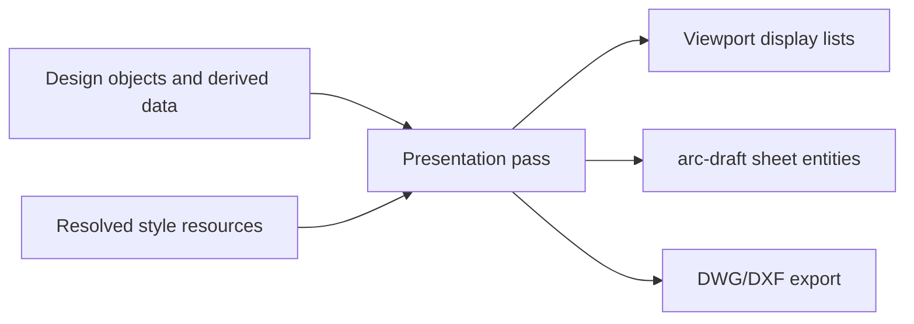

# Styles and labels

How display is defined in CivilBuilder: object styles, label styles with expressions and anchoring,
tables, inheritance, libraries and templates, and how all of it stays separate from design data. The
governing decision is [ADR-0004](../adr/0004-styles-separate-from-design-data.md).

## Separation from design data

- Style resources (object styles, label styles, label sets, table styles, code style sets, marker
  definitions, display sets) are document resources with their own identifiers, stored in their own
  tables of the document package.
- A design object stores only a style identifier and its label attachments. No regeneration node
  takes a style as input, so changing a style never recomputes design data.
- Display is produced by a separate **presentation pass**: for each view, visible objects and their
  current derived data are combined with resolved styles into display lists (viewport) or `arc-draft`
  entities (sheets and drafting export).
- Label content reads design data but never writes it; label layout results are presentation caches.

## Object styles

An object style belongs to one object type and lists that type's **display components** (for a
corridor: links, points, shapes, feature lines, slope patterns). For each component and each view
direction (plan, 3D, profile, section) it sets visibility, layer, color, linetype, lineweight,
transparency and render material. View directions are fixed per object type; the profile direction
applies to objects projected into profile views.

Code style sets are object-style resources that map point, link and shape codes to display, labels
and materials. Display sets (per view or sheet viewport) override component visibility and
appearance by object type or style without editing styles.

## Label styles

A label style is a set of components:

| Component | Content |
|---|---|
| Text | Literal text, property fields and expressions |
| Line, tick, direction arrow | Geometry relative to anchors |
| Marker | A marker definition |
| Reference text | Content from a second, referenced object |

**Anchoring.** Each component anchors to a named point of the labeled geometry (start, end, midpoint,
insertion, station point, vertex, segment) or to a named point of another component (for example the
bottom-left of a text box), with offsets in paper units, justification and rotation rules. Anchor
names are defined per label type, so a style is valid for every object of that type.

**Content.** Property fields bind to properties exposed by the object type (for example a profile
point's station, elevation, grade in and grade out). Each field has formatting: precision, unit,
rounding mode, sign convention, direction format and station format, defaulting from the settings
hierarchy.

**Expressions.** Expressions use the unit-aware expression language of `arc-solve`: arithmetic,
comparisons, conditionals and text and number functions over the object's properties. Expressions
are type-checked against the label type when the style is saved; an expression that fails at
evaluation shows a visible error marker in place of its value and is listed in the style validation
report. Expressions cannot write to the model and have bounded evaluation cost.

**Behaviors.** Orientation (object, view, world), plan readability with a flip angle relative to the
viewing direction or sheet rotation, a dragged state with leader and stacked layout, and optional
collision avoidance. Sizes are in paper units and scale with the annotation scale of the view.

**Label sets** group label styles by role for one object type (for example major stations, minor
stations, geometry points, station equations, design speeds) and apply as a unit.

## Tables

A table style defines columns (header, property field or expression, format), title and header rows,
sort order, row filter and splitting rules. A table instance binds a table style to a selection rule
(explicit objects, a point group, all parcels of a site, a material list, a pay item catalog) and
updates in the presentation pass when its objects change. Tags replace labels with row references;
tag numbers are authored data on the tag, assigned by numbering commands.

## Inheritance

- A style may name a parent style of the same type. Each value is either overridden in the child or
  inherited; the resolved value is the nearest override up the chain.
- Chains are acyclic and bounded in depth; cycles are rejected at commit.
- The style editor shows for each value whether it is inherited and from where.
- The same rule applies to the settings hierarchy: document, then object type, then command.

## Libraries and templates

- A **style library** is a versioned collection of style resources and settings stored as
  text-diffable files with a manifest, so standards are reviewed and versioned like code.
- A document references libraries and keeps a resolved local copy of every resource it uses, so it
  opens and renders without the library.
- Updating from a library computes a difference (added, changed, removed resources) and applies it in
  one transaction after review. Local overrides of library styles are kept as child styles.
- A **template** is a document that seeds new documents with settings, styles, label sets, table
  styles, criteria sets, component libraries, catalogs and sheet templates.
- The **standards audit** (CB-STY-022) compares a document with its libraries and runs headless.

## Rendering into drafting output

On sheets and in DWG/DXF export, the presentation pass emits `arc-draft` entities on layers named by
the layer naming rules, with annotation scale applied per viewport. The emitted entities carry the
source object identifier so selection on a sheet resolves to the model object.
